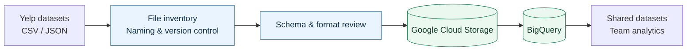

# Yelp Cloud Data Integration & Analytics

**Google Cloud Storage · BigQuery · Python · SQL · Data Quality**

A cloud data integration project supporting restaurant analytics using Yelp datasets. I organised the shared data foundation for a university team project, preparing source files in Google Cloud Storage and setting up the workflow for analysis in BigQuery.

## Project overview

The team worked with Yelp business, review and check-in data to explore restaurant performance. My focus was making the datasets consistent, accessible and ready for downstream analysis.

### My contribution

- **Cloud storage:** Organised source datasets in Google Cloud Storage with a consistent bucket and folder structure.
- **Data standardisation:** Standardised file names and CSV/JSON formats, removed redundant files and identified the final dataset versions.
- **Schema preparation:** Checked dataset fields and structures before ingestion.
- **BigQuery integration:** Set up data loading and table structures to support the team's analysis.
- **Collaboration:** Prepared and shared datasets with teammates responsible for the individual analysis workstreams.

## Data workflow



The diagram shows the project workflow. My focus was preparing the source files, organising cloud storage and setting up the BigQuery integration for the team.

## Technical examples

The repository also includes small, self-contained examples of data validation and quality checks, using sample data.

| Explore | Description |
| --- | --- |
| [Cloud integration case study](docs/case_study.md) | Project context, responsibilities and technical decisions |
| [Data architecture](docs/architecture.md) | End-to-end data flow and validation checkpoints |
| [Data organisation](docs/data_governance.md) | File naming, formats, schema readiness and version control |
| [Source manifest validator](src/source_manifest.py) | Python checks for file metadata, versions, paths and schemas |
| [Validation walkthrough](docs/manifest_validation.md) | How the source manifest checks work |
| [Check-in data example](src/checkin_quality.py) | Python timestamp parsing and quality profiling |
| [BigQuery SQL example](sql/checkin_quality_checks.sql) | SQL checks for timestamp validity |
| [Example validation results](docs/demo_output.md) | Reproducible sample output and quality checks |
| [Unit tests](tests/) | Tests for the Python validation functions |

## Try it locally

**Requirements:** Python 3.10+; no external packages.

```bash
python src/source_manifest.py
python src/checkin_quality.py
python -m unittest discover -s tests -v
```

The runnable examples use synthetic data to demonstrate related validation techniques. The project description covers my cloud integration work; the analytical workstreams were completed collaboratively.

## Skills demonstrated

**Cloud data integration** · **Data preparation** · **Schema validation** · **Data quality** · **Python** · **SQL** · **Cross-functional collaboration**
